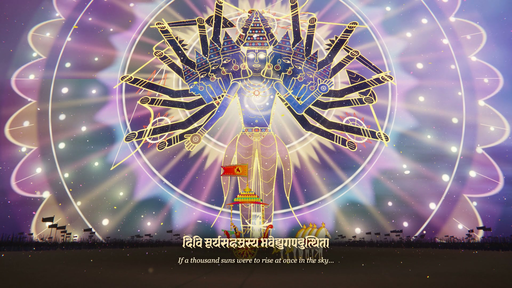

# Virat Roop — the Universal Form

An 84-second film in one HTML file: Krishna shows Arjuna his universal form on the field of Kurukshetra
(Bhagavad Gita, chapter 11). three.js r180, everything else is code: no models, no images, no network requests.

- `index.html` — the film. Open it (works from `file://`). Click for sound, space to pause, `M` to mute.
- `virat-roop.mp4` — the same film rendered offline, 1920x1080, 30 fps, with the score.
- `src/` — the numbered modules `index.html` is built from. `python3 tools/build.py` rebuilds it.

## The look

A living shadow-theatre painting, made like jewellery. Krishna, Arjuna, the canopied chariot and the four white
horses are jointed figures cut as Indian shadow puppets are (profile heads, frontal chests), but built as
plique-a-jour: cells of translucent enamel held in raised gold wire, set with stones and pearls. Each sheet carries a
hidden second drawing of its relief (height, gold, stone), so the figures are embossed and really lit: the sun shines
through the enamel from behind and a soft key rakes the gold. They stand in a deep 3D plain between two instanced
hosts. The universal form is a frontal icon the height of the sky drawn in gold line, its body the night itself,
with a wheel of arms, a fan of faces, a polychrome halo of suns closed by a ring of lotus petals; flowers rain down
through the vision and the dawn.

## Beat sheet (3 s bars at 80 bpm; every cut is on a bar line)

| s | |
|---|---|
| 0 | Kurukshetra: a crane down the open ground between the hosts |
| 9 | the chariot in profile; Arjuna lowers the bow and sinks |
| 18 | Krishna turns, lifts his hand; the wind stops (banners, dust and horses hold still) |
| 27 | he opens his arms; a column of light |
| 33 | the form; arms and faces unfurl (11.12) |
| 45 | rising up the body: the galaxy at the heart, the faces |
| 54 | Kala: the lights of the warriors run like rivers to the mouth of Time (11.32) |
| 66 | the form folds back; Arjuna, hands joined |
| 75 | dawn; he stands and lifts the bow |

Every frame is a pure function of film time: `index.html?t=41&pause=1` holds any frame.

## Tools

- `sh tools/sheet.sh NAME "t0,t1,..." [cols] [cell]` — headless contact sheet to `_shots/NAME.jpg`
- `node tools/wav.mjs` — renders the score to `_out/score.wav` and checks the mix (peak, NaN, loudest window)
- `sh tools/record.sh 30 virat-roop.mp4 _out/score.wav` — offline frame-by-frame render and encode
- `sh tools/console.sh "t=40"` — prints the page console (shader errors) from a headless run

## Credits and licences

- three.js (MIT) and the Jaini typeface by Ek Type (SIL OFL 1.1) are embedded; see `vendor/LICENSE`.
- The verses are from the Bhagavad Gita (11.5, 11.12, 11.32); the English lines are our own renderings.
- All drawings, shaders and the synthesised score are original to this project.
- Built with Claude Code. No licence is granted for the film's own code, drawings and score (all rights reserved)
  unless one is added here; the embedded third-party pieces keep their own licences above.
